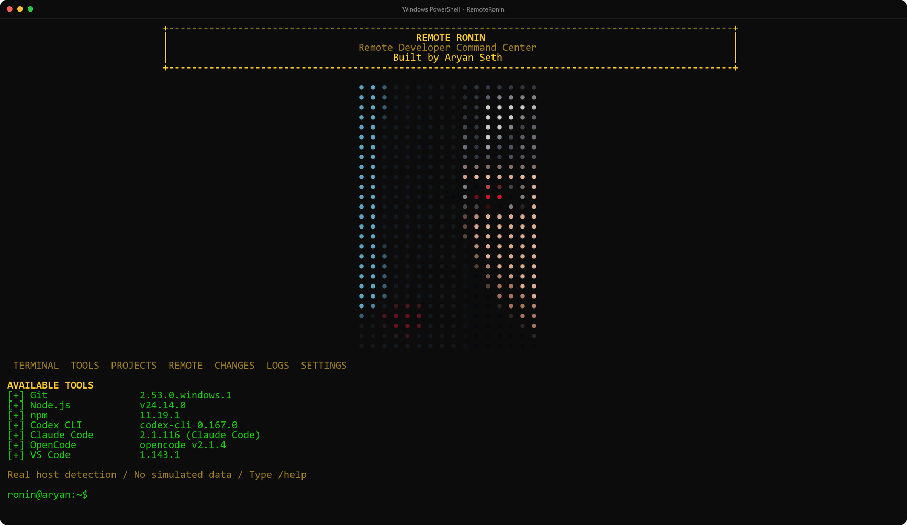
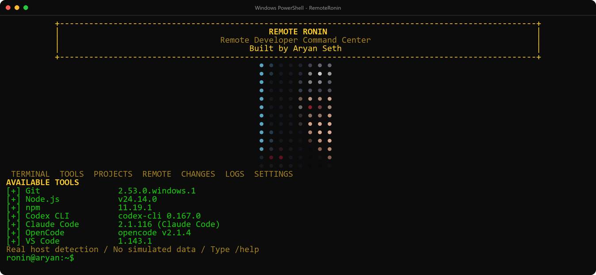
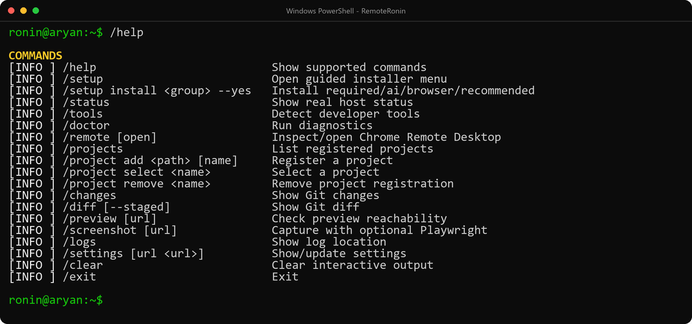
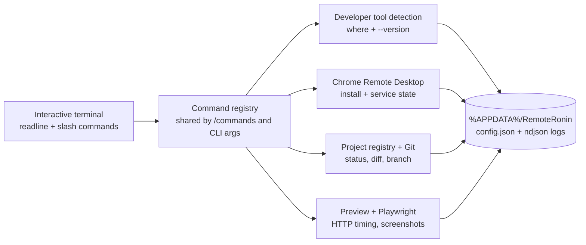

<div align="center">



# RemoteRonin

**One installation. One terminal. Multiple developer tools. Remote access from anywhere.**

[](https://github.com/AryanSeth009/RemoteRonin)
[](https://nodejs.org)
[](#-how-it-works)
[](#-development)
[](LICENSE)

[Quick start](#-quick-start) · [Screenshots](#-screenshots) · [Commands](#-command-reference) · [How it works](#-how-it-works) · [Troubleshooting](#-troubleshooting)

</div>

---

## What is RemoteRonin?

RemoteRonin is a Windows command center that lives in your terminal. It checks what is actually installed on the machine, opens the official Chrome Remote Desktop setup, registers your projects, reviews Git changes, and verifies browser previews — without a browser window, a background server, or a cloud account.

The core is a single Node.js file that imports **nothing outside the standard library**, so cloning and running it never depends on a package registry.

| | |
|---|---|
|  **Real host detection** | Reports installed tools, versions, the Chrome Remote Desktop host and service state. Missing tools stay `NOT FOUND` — nothing is simulated. |
|  **Shinobi startup artwork** | A true-color dot-matrix portrait resampled to your terminal's real rows and columns, so the whole screen fits without scrolling. |
|  **Guided installer** | `/setup` walks through required core, AI developer tools, browser verification, or everything — with explicit approval before anything downloads. |
|  **Project registry** | Register folders once, switch the active project, then inspect real Git status and diffs. |
|  **Preview checks** | Time a URL, and optionally capture a Playwright screenshot with console and network errors. |
|  **Nothing secret touches disk** | No PINs, tokens, cookies, or provider credentials are read, stored, or logged. |

---

##  Quick start

### 1. Check you have what you need

| Requirement | Why RemoteRonin needs it | Check it |
|---|---|---|
| **Windows 10 / 11** | The runtime targets Windows specifically | `$env:OS` |
| **Node.js ≥ 20** | Runs the CLI and the installer | `node --version` |
| **npm** | Ships with Node; used by `setup.ps1` and optional packages | `npm --version` |
| **Git** | Powers `/changes`, `/diff`, and project cloning | `git --version` |
| **PowerShell 5.1+** | Runs `setup.ps1` and `verify-install.ps1` | `$PSVersionTable.PSVersion` |

Missing something? Install [Node.js LTS](https://nodejs.org) and [Git for Windows](https://git-scm.com/download/win), then reopen the terminal so `PATH` refreshes.

### 2. Clone the repository

```powershell
git clone https://github.com/AryanSeth009/RemoteRonin.git
cd RemoteRonin
```

### 3. Install

```powershell
.\setup.ps1
```

`setup.ps1` verifies that `node`, `npm` and `git` resolve, runs syntax validation, runs the test suite, and tells you when the terminal is ready. It is safe to re-run; it touches no credentials and installs nothing on its own.

<details>
<summary>Blocked by “running scripts is disabled on this system”?</summary>

```powershell
powershell -ExecutionPolicy Bypass -File .\setup.ps1
```

</details>

### 4. Launch

```powershell
.\start.cmd
```

The startup screen appears, every tool is detected live, and the `ronin@aryan:~$` prompt is yours.

### 5. Optional — let RemoteRonin install the rest

Inside the terminal:

```text
/setup
```

```text
INSTALLATION MENU
1. Required core + remote access
2. AI developer tools
3. Browser verification (Playwright + Chromium)
4. Everything recommended
5. Verify only / install nothing
0. Cancel
Select [0-5]:
```

Every selection is shown with its scope and asks for confirmation before downloading software or requesting Windows approval. Components whose health check already passes are skipped.

For unattended scripts, the same action requires an explicit flag:

```powershell
.\start.cmd setup install recommended --yes
```

### Optional — browser screenshots

`/screenshot` is the only feature that needs a package, and it is optional:

```powershell
npm install playwright
npx playwright install chromium
```

---

## 📸 Screenshots

The hero image above is the real startup screen at 155 × 49 with a zoomed console font — not a mock. The portrait is resampled for that viewport, so nothing scrolls. Here is how the same screen adapts:

<div align="center">

<sub><b>Compact view.</b> In a 120×30 window the portrait shrinks and the decorative padding collapses so everything still fits.</sub>
</div>

<br />

<div align="center">

<sub><b>Command list.</b> <code>/help</code> always reflects the actual command registry.</sub>
</div>

---

## ⌨️ Command reference

Every command works interactively (`/tools`) and, unless marked otherwise, non-interactively (`.\start.cmd tools`).

| Command | What it does | Non-interactive |
|---|---|---|
| `/help` | List every supported command | `.\start.cmd help` |
| `/setup` | Open the guided installer menu | — |
| `/setup install <required\|ai\|browser\|recommended> --yes` | Install a group with explicit approval | `.\start.cmd setup install recommended --yes` |
| `/status` | Host, OS, Node version, tool and remote summary | `.\start.cmd status` |
| `/tools` | Detect developer tools and versions | `.\start.cmd tools` |
| `/doctor` | Run diagnostics and report failures | `.\start.cmd doctor` |
| `/remote [open]` | Inspect the Chrome Remote Desktop host, or open the official page | `.\start.cmd remote open` |
| `/projects` | List registered projects | `.\start.cmd projects` |
| `/project add <path> [name]` | Register a folder as a project | `.\start.cmd project add "D:\Projects\My App" "My App"` |
| `/project select <name>` | Make a project active | `.\start.cmd project select "My App"` |
| `/project remove <name>` | Forget a project (files are untouched) | `.\start.cmd project remove "My App"` |
| `/changes` | Real `git status` for the active project | `.\start.cmd changes` |
| `/diff [--staged]` | Real `git diff`, optionally staged | `.\start.cmd diff --staged` |
| `/preview [url]` | Time a URL and report HTTP status | `.\start.cmd preview http://localhost:3000` |
| `/screenshot [url]` | Capture with Playwright, report console/network errors | `.\start.cmd screenshot http://localhost:3000` |
| `/logs` | Print the log file location | `.\start.cmd logs` |
| `/settings [url <url>]` | Show or update settings | `.\start.cmd settings` |
| `/settings art on\|off` | Toggle the startup artwork | `.\start.cmd settings art off` |
| `/clear` | Redraw the startup screen | — |
| `/exit` | Leave the session | — |

---

## ⚙️ How it works



**Why one file?** `src/cli/runtime.js` holds the registry, detection, artwork and storage helpers so the tool can be copied to a machine and run with `node` alone. The only optional dependency is Playwright, and it is loaded lazily inside `/screenshot`.

```text
RemoteRonin/
├─ src/cli/runtime.js         # CLI: command registry, detection, artwork, storage
├─ config/default.json        # Seed configuration
├─ scripts/verify-install.ps1 # npm run check wrapper
├─ tests/                     # node --test: parser + startup layout fit
├─ assets/images/             # Screenshots used by this README
├─ setup.ps1                  # One-time installer
└─ start.cmd                  # Launcher (interactive or one-shot command)
```

### Startup artwork

The portrait is a 30 × 50 grid of true-color dots. On launch RemoteRonin measures the terminal, reserves the rows needed by the branding box, menu and tool list, then resamples the portrait to the remaining space — so the full screen fits at any window size or console font, and `/clear` re-fits it after you resize.

```text
/settings art off     # plain startup, no portrait
/settings art on      # bring it back
```

Narrow (< 64 columns) or `NO_COLOR` terminals automatically fall back to a compact ASCII mark instead.

---

## 🗂️ Configuration and local data

Everything user-specific lives outside the repository:

| What | Where |
|---|---|
| Config (`projects`, `previewUrl`, `showArtwork`) | `%APPDATA%\RemoteRonin\config.json` |
| Redacted NDJSON logs | `%APPDATA%\RemoteRonin\logs\remoteronin.ndjson` |
| Screenshots from `/screenshot` | `%APPDATA%\RemoteRonin\screenshots\` |

| Variable | Effect |
|---|---|
| `REMOTERONIN_HOME` | Use a different data directory |
| `DEVREMOTE_HOME` | Legacy name, still supported |
| `NO_COLOR` | Disables ANSI color and switches to the compact mark |

If `%APPDATA%` is read-only, RemoteRonin falls back to `.remoteronin\` inside the current folder and keeps going.

---

## 🩺 Troubleshooting

| Symptom | Fix |
|---|---|
| `running scripts is disabled on this system` | `powershell -ExecutionPolicy Bypass -File .\setup.ps1` |
| `node is not recognized` | Install Node.js LTS, then open a **new** terminal so `PATH` refreshes |
| A tool shows `NOT FOUND` although it is installed | The current shell predates the install — reopen the terminal and run `/tools` |
| `winget` missing during `/setup` | Install **App Installer** from the Microsoft Store, or install that tool manually |
| Chromium download fails | Run `npm install playwright` then `npx playwright install chromium` yourself |
| Portrait looks cluttered or the window is tiny | `/settings art off`, or widen the terminal; very narrow windows get the compact mark |
| Colors are missing | `NO_COLOR` is set — remove it from the environment and restart |
| Remote access still asks for Google sign-in | Expected: Chrome Remote Desktop authorization and PIN creation are always manual on Google's official page |

---

## 🔐 Safety and privacy

- **No credentials.** RemoteRonin never reads, stores, or logs remote-access PINs, tokens, cookies, or provider credentials.
- **No secrets in logs.** Log lines pass through a redaction filter before they are written.
- **Explicit consent.** Downloads, installs, and elevation prompts only happen after you confirm the scope.
- **No public server.** Nothing listens on a port; everything runs in your terminal.
- **No simulated data.** Detection results come from the host; unknown states stay unknown instead of being invented.

---

## 🛠️ Development

```powershell
npm run build     # node --check on the runtime
npm test          # node --test tests/*.test.js
npm run check     # build + tests + doctor
.\scripts\verify-install.ps1
```

The test suite covers command parsing, installer approval gating, and the startup layout: for viewports from 80×24 to 400×120 it asserts that the rendered screen never exceeds the terminal's rows or columns.

### Roadmap

- Managed development-process start/stop with live log streaming
- Provider launch actions after command-capability verification
- MCP configuration validation without credential access
- Signed Windows installer and a GitHub Actions release pipeline

Known gaps that need real hardware: Chrome Remote Desktop sign-in from a separate network, the Playwright flow on a freshly installed Chromium, and a clean Windows 10/11 re-install test.

---

## 📄 License

[MIT](LICENSE) — built by **Aryan Seth**.

<div align="center">
<sub>If RemoteRonin saves you a browser tab, consider starring the repository.</sub>
</div>
